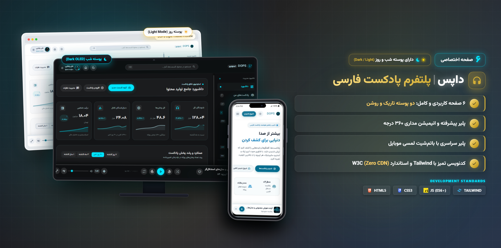

<div align="center">
  

  <h1>DOPS — Premium Persian RTL Podcast HTML5 Template</h1>
  <p><strong>پوسته HTML5 تخصصی پادگیر، رسانه صوتی و پلیر آنلاین با هیرو مداری ۳۶۰ درجه و استایل سایبرنتیک دارک OLED</strong></p>

  <p>
    <a href="https://mohammad-nematzadeh.github.io/dops/" target="_blank"></a>
    
    
    
    
  </p>

  <p>
    <a href="https://mohammad-nematzadeh.github.io/dops/"><strong>🔗 مشاهده پیش‌نمایش زنده در GitHub Pages: mohammad-nematzadeh.github.io/dops</strong></a>
  </p>
</div>

---

# قالب HTML پادکست فارسی دوپس (DOPS)
### DOPS — Premium Persian RTL Podcast HTML5 Template (Commercial Edition)

قالب **DOPS (دوپس)** یک قالب مدرن، آینده‌نگرانه و استاندارد برای وب‌سایت‌های پادکست، پلتفرم‌های پخش محتوای صوتی، رادیوهای اینترنتی و پایگاه‌های آموزشی فارسی است. این قالب بر اساس جدیدترین متدهای طراحی وب با رعایت کامل اصول **RTL (راست‌چین اصیل)**، تایپوگرافی چشم‌نواز با فونت محبوب **وزیرمتن (Vazirmatn)** و سیستم تم دوگانه واقعی (تیره و روشن) توسعه یافته و به صورت **۱۰۰٪ محلی، خودکفا و آماده استقرار** ارائه شده است.

---

## 🌟 امکانات و قابلیت‌های کلیدی قالب

1. **طراحی راست‌چین اصیل و مهندسی‌شده (True RTL)**:
   - بهره‌گیری از خصوصیات منطقی CSS مدرن (`margin-inline`، `padding-inline`، `inset-inline`).
   - تعبیه سایدبارهای راست، چیدمان بهینه کنترل‌های صوتی و نمایش اعداد فارسی استاندارد (`۰ ۱ ۲ ۳ ۴ ۵ ۶ ۷ ۸ ۹`).

2. **پخش‌کننده صوتی سراسری شناور (Persistent HTML5 Audio Player)**:
   - پلیر صوتی مستقل و شناور در پایین صفحات با استفاده از تگ استاندارد HTML5 `<audio>`.
   - امکانات کامل: پخش (Play)، مکث (Pause)، پرش زمانی ۱۵ ثانیه‌ای به عقب و ۳۰ ثانیه‌ای به جلو، اسلایدر تنظیم بلندی صدا (Volume)، قطع صدا (Mute)، و تغییر هوشمند سرعت پخش (`1.0x`, `1.25x`, `1.5x`, `2.0x`).
   - اسکرابر موج صوتی (Waveform) با قابلیت کلیک و پرش زمانی متناسب با چیدمان راست‌چین (RTL Seek).
   - اتصال مستقیم تمامی کارت‌ها و ردیف‌های پادکست در صفحات به پلیر اصلی با اتریبیوت `data-podcast-play`.

3. **سیستم تم دوگانه شب و روز (Dark & Light Mode)**:
   - تم تاریک پیش‌فرض با رنگ زمینه عمیق `#050505` و هایلایت‌های نئونی سایان (`#00E5FF`).
   - تم روشن ارگونومیک با رنگ زمینه سفید `#FFFFFF` و متن ذغالی با کنتراست استاندارد.
   - بدون کوچک‌ترین پرش نور هنگام لود صفحه (Zero FOUC) با ذخیره‌سازی سلیقه کاربر در `localStorage`.

4. **۱۰۰٪ محلی و بی‌نیاز از هرگونه CDN خارجی (Offline & Standalone Ready)**:
   - تمام فایل‌های فونت وزیرمتن و آیکون‌های Material Symbols در پکیج قرار دارند.
   - استایل‌های کاربردی و کامپوننت‌ها به صورت یکپارچه در فایل `assets/css/style.css` کامپایل شده‌اند و قالب هیچ نیازی به Node.js، NPM یا CDN ندارد.

5. **استودیو سازندگان و نمودار تحلیلی تعاملی (SVG Curve Chart)**:
   - نمودار وکتور با خط منحنی صاف، گرادیان پرشونده، تولتیپ تعاملی و فیلترهای زمانی (۷ روز، ۳۰ روز، ۳ ماه، ۱ سال).
   - جدول مدیریت اپیزودها با قابلیت اسکرول افقی واکنش‌گرا و برچسب‌های وضعیت.

6. **پنل اختصاصی شنونده (Listener Dashboard)**:
   - نمایش پلی‌لیست‌ها، اپیزودهای نشان‌شده، شاخص مصرف حافظه آفلاین و آمار شنیداری.

7. **فرم ارگونومیک ورود و عضویت (`login.html` و Modal)**:
   - تب‌بندی سریع برای جابجایی میان فرم ورود و ثبت‌نام با بازخورد اعلان زنده (Toast).

---

## 📁 ساختار پوشه‌ها و فایل‌های پروژه

```text
DOPS/
│
├── index.html                   # صفحه اصلی (مدار صوتی، محبوب‌ترین‌های هفته، انتخاب تحریریه، دسته‌بندی‌ها)
├── podcast.html                 # صفحه اختصاصی پادکست (مشخصات، راوی، فیلتر اپیزودها، دیدگاه‌ها)
├── episode.html                 # صفحه تک‌قسمت پادکست (پلیر استودیویی، فصول زمانی، رونوشت متن)
├── listener-dashboard.html      # میز کار و پنل اختصاصی شنونده (پلی‌لیست‌ها، تاریخچه، حافظه آفلاین)
├── creator-dashboard.html       # استودیو سازندگان محتوا (نمودار آماری، جدول قسمت‌ها، تحلیل درآمد)
├── login.html                   # صفحه ورود و ثبت‌نام مستقل کاربر
├── README.md                    # راهنمای جامع فارسی و مستندات شخصی‌سازی (همین فایل)
├── LICENSE.txt                  # مجوز استفاده تجاری و لایسنس‌های شخص ثالث
├── favicon.ico                  # فاوآیکون ریشه سایت برای مرورگرها
│
└── assets/
    ├── css/
    │   ├── style.css            # استایل‌شیت اصلی، متغیرهای طراحی، کامپوننت‌ها و استایل‌های کامپایل‌شده
    │   ├── vazirmatn.css        # تعاریف محلی @font-face فونت وزیرمتن و آیکون‌های Material Symbols
    │   └── animations.css       # انیمیشن‌های مداری، هاله نئونی و پالس‌های زنده
    │
    ├── js/
    │   ├── dops-theme.js        # کنترلر سوئیچ تم تیره و روشن (ذخیره خودکار در localStorage)
    │   ├── dops-player.js       # موتور پلیر صوتی سراسری HTML5 و اسکرابر سازگار با RTL
    │   ├── dops-ui.js           # مدیریت دراورهای موبایل، مدال‌ها، تب‌ها، اعلان‌ها و میانبرها
    │   └── dops-charts.js       # موتور رسم نمودار تحلیلی وکتور در داشبورد سازندگان
    │
    ├── fonts/
    │   ├── vazirmatn/           # ۷ فایل WOFF2 استاندارد فونت وزیرمتن (اوزان ۳۰۰ تا ۹۰۰)
    │   └── material-symbols/   # فونت آیکون محلی Material Symbols Outlined (TTF)
    │
    ├── images/
    │   ├── logo/                # لوگوی وکتور SVG، نشان تجاری و فاوآیکون برداری
    │   ├── podcasts/            # کاورهای باکیفیت بهینه‌شده پادکست‌ها
    │   ├── avatars/             # تصاویر پروفایل گویندگان و کاربران
    │   └── banners/             # بنرهای استودیویی و پس‌زمینه
    │
    └── audio/
        ├── sample-episode.mp3   # فایل صوتی نمونه اصلی MP3 (کیفیت استریو)
        └── sample-episode.wav   # نسخه پشتیبان سازگار صوتی
```

---

## 🚀 نحوه اجرا و راه‌اندازی

این قالب یک قالب **استاتیک تجاری (Pure Static HTML5/CSS3/Vanilla JS)** است و بدون نیاز به نصب هیچ ابزاری اجرا می‌شود:

1. فایل ZIP دریافتی را استخراج (Unzip) کنید.
2. تمام فایل‌ها و پوشه `assets` را مستقیماً بر روی هر هاست دلخواهی شامل:
   - آپاچی (Apache)
   - انجین‌ایکس (Nginx)
   - لایت‌اسپید (LiteSpeed)
   - کنترل‌پنل‌های سی‌پنل (cPanel) یا دایرکت‌ادمین (DirectAdmin)
   - گیت‌هاب پیجز (GitHub Pages) یا سایر هاست‌های استاتیک
   آپلود نمایید.
3. فایل `index.html` به عنوان صفحه اصلی وب‌سایت شما باز خواهد شد.

---

## 🎨 راهنمای جامع شخصی‌سازی (Customization Guide)

### ۱. نحوه تغییر نام برند و لوگو:
لوگوی متنی و برداری DOPS در فایل‌های HTML در تگ `<header>` به صورت وکتور SVG قرار دارد. برای تغییر عنوان برند:
- متن `DOPS` را در تگ `<text>` لوگو با نام دلخواه خود جایگزین کنید.
- فایل وکتور نشان تجاری در مسیر `assets/images/logo/` نیز قابل تعویض با لوگوی تصویر دلخواه شماست.

### ۲. نحوه تغییر رنگ‌های قالب (Color Palette):
در ابتدای فایل `assets/css/style.css` متغیرهای پالت رنگ در بخش `:root` (حالت تیره) و `html.light` (حالت روشن) تعریف شده‌اند:
```css
:root, html.dark {
  --color-primary: #00E5FF;       /* رنگ اصلی سایان نئونی */
  --color-primary-soft: #67F3FF;  /* رنگ هاله و سایه ملایم */
  --bg-canvas: #050505;           /* رنگ پس‌زمینه سراسری */
  --bg-surface: #0D0F10;          /* رنگ کارت‌ها و سطوح */
  --text-primary: #F5F7F8;        /* رنگ متون اصلی */
}
```
تنها با تغییر کد رنگ این متغیرها، پالت رنگی کل صفحات به صورت یکپارچه به‌روزرسانی می‌شود.

### ۳. نحوه تغییر فونت:
فونت پیش‌فرض قالب **وزیرمتن (Vazirmatn)** است که فایل‌های استاندارد WOFF2 آن در پوشه `assets/fonts/vazirmatn/` قرار دارد.
اگر مایل به تغییر فونت به فونت دیگری هستید:
1. فایل‌های فونت جدید خود را در پوشه `assets/fonts/` کپی کنید.
2. مسیر فایل‌ها را در فایل `assets/css/vazirmatn.css` جایگزین نمایید.

### ۴. نحوه تغییر اطلاعات پادکست‌ها و اپیزودها:
تمام عناوین، اسامی راویان، توضیحات، تگ‌ها و فصول پادکست به زبان فارسی با انکودینگ UTF-8 در فایل‌های HTML قرار دارند و با هر ویرایشگری (مانند VS Code یا Notepad++) قابل ویرایش هستند.

### ۵. نحوه اتصال دکمه‌ها به فایل‌های صوتی دلخواه:
برای اینکه هر دکمه در هر کجای وب‌سایت، فایل صوتی دلخواه شما را در پلیر سراسری پخش کند، کافیست اتریبیوت‌های داده زیر را اضافه کنید:
```html
<button type="button" class="play-episode-btn"
        data-podcast-play="true"
        data-track-title="عنوان اپیزود جدید شما"
        data-track-podcast="نام پادکست • اپیزود ۴۲"
        data-track-artwork="assets/images/podcasts/cover-donye-farda.png">
  <span>پخش اپیزود</span>
</button>
```
همچنین می‌توانید مسیر فایل صوتی واقعی پادکست خود را در فایل `assets/js/dops-player.js` در شیء `defaultTrack` و تابع `window.dopsPlayTrack` قرار دهید.

### ۶. نحوه تغییر تصاویر و کاورها:
تصاویر به صورت منظم در پوشه `assets/images/` دسته‌بندی شده‌اند:
- کاور پادکست‌ها: `assets/images/podcasts/` (نسبت ابعاد ۱:۱ مربع)
- تصاویر پروفایل: `assets/images/avatars/` (نسبت ابعاد ۱:۱ مربع)
- بنرها: `assets/images/banners/` (نسبت ابعاد ۱۶:۹)

---

## 🌐 سازگاری با مرورگرها (Browser Compatibility)

این قالب با کلیه مرورگرهای مدرن سازگار است:
- Google Chrome (نسخه ۸۵ و بالاتر)
- Mozilla Firefox (نسخه ۸۰ و بالاتر)
- Microsoft Edge (نسخه ۸۵ و بالاتر)
- Apple Safari (نسخه ۱۴ و بالاتر بر روی macOS و iOS)
- مرورگرهای استاندارد موبایل (اندروید و آیفون)

---

## 👏 حقوق نشر و منابع شخص ثالث (Credits & Third-Party)

- **فونت فارسی وزیرمتن (Vazirmatn)**: اثر استاد زنده‌یاد صابر راستی‌کردار، تحت مجوز آزاد SIL Open Font License 1.1 (OFL).
- **مجموعه آیکون‌های Material Symbols**: اثر کمپانی Google، تحت مجوز Apache License 2.0.
- **لایه ریست CSS (Tailwind CSS Preflight)**: تحت مجوز متن‌باز MIT License (کامپایل‌شده محلی).
- **اسکریپت‌های تعاملی و پلیر**: به صورت کاملاً مستقل و با جاوااسکریپت خالص (Vanilla JS) بدون وابستگی به هیچ فریم‌ورک خارجی نوشته شده است.

---

## 📄 اطلاعات لایسنس تجاری (License Information)

قالب تحت لایسنس تجاری معتبر ارائه شده است. خریدار مجاز به استفاده و شخصی‌سازی این قالب بر روی وب‌سایت‌های شخصی یا پروژه‌های کارفرمایان خود می‌باشد. بازنشر یا فروش مجدد فایل‌های سورس قالب ممنوع است. لطفاً فایل [LICENSE.txt](file:///f:/web%20design/stitch_dops_persian_podcast_template/stitch_dops_persian_podcast_template/LICENSE.txt) را مطالعه فرمایید.
